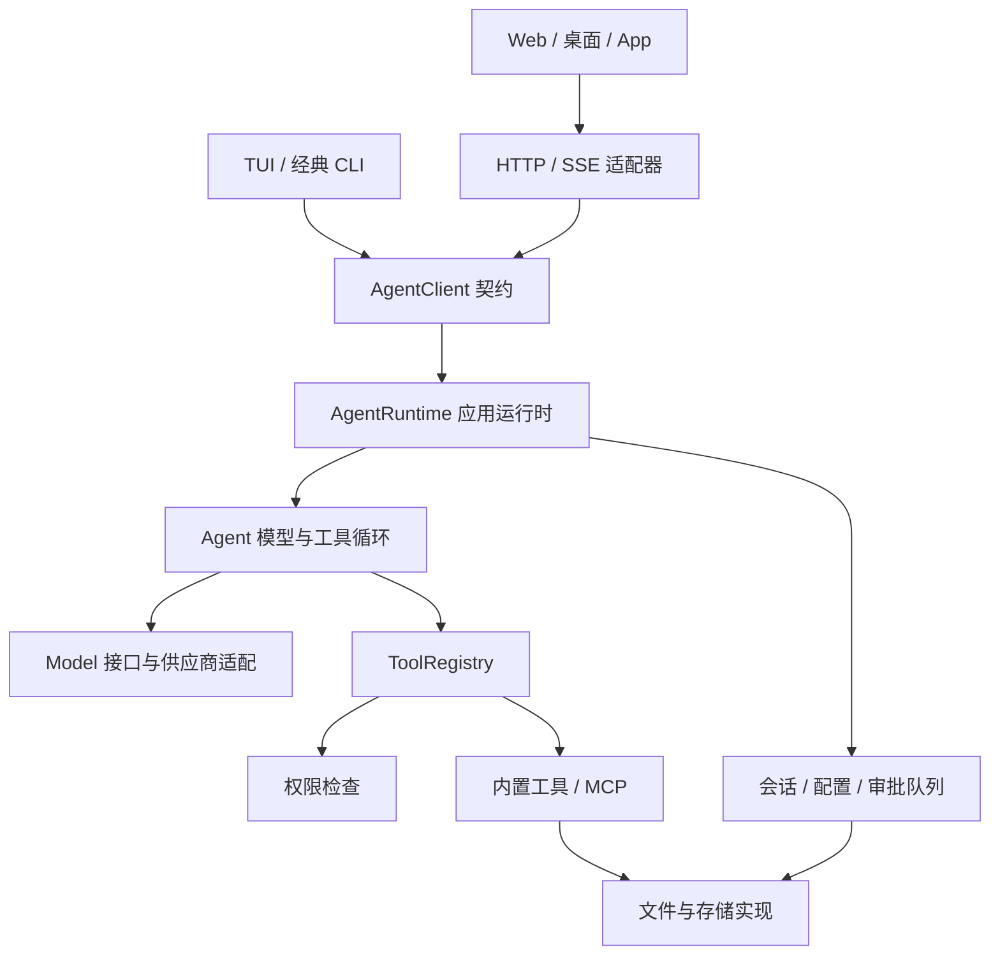
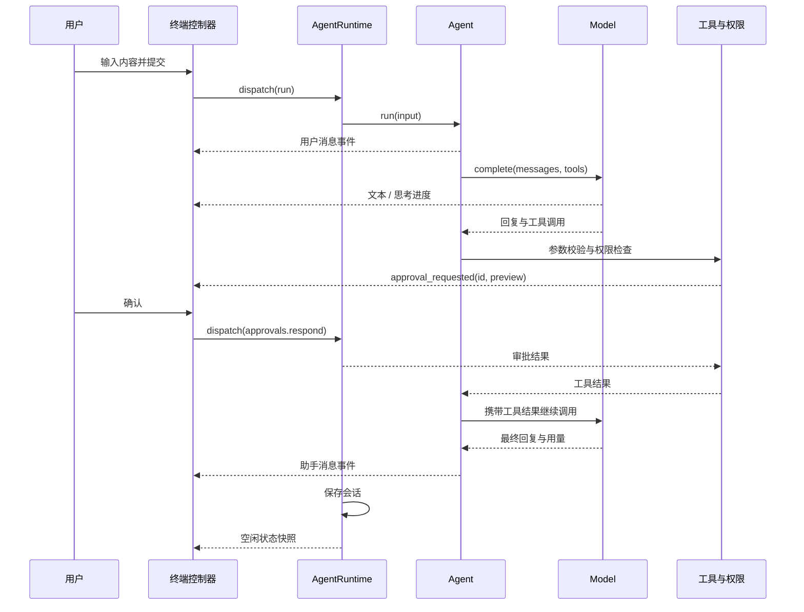

# Mini Agent 架构学习指南

这份指南对应当前代码。建议先理解一条消息如何经过整个系统，再阅读模型协议、工具权限和存储细节。

## 1. 先看四层边界



| 层       | 负责                                               | 主要文件                                    |
| -------- | -------------------------------------------------- | ------------------------------------------- |
| 展示     | 处理键盘、命令语法和布局，把事件映射成界面状态     | `src/presentation/`                         |
| 应用     | 初始化服务、管理会话、派发动作、等待审批、保存数据 | `src/app/`                                  |
| 核心     | 调用模型、执行工具、维持消息顺序、计算用量         | `src/core/`                                 |
| 外部实现 | 文件、配置、记忆、命令进程、MCP 和网络传输         | `src/infra/`、`src/tools/`、`src/adapters/` |

`src/tui.ts`、`src/cli.ts` 和 `src/server.ts` 是入口：它们负责把运行时与对应界面或服务连接起来。只有这些装配入口需要同时知道应用实现和界面实现。

核心和应用层不导入 Pi TUI、Ink、React 或展示组件。终端控制器也不创建模型、执行工具或直接读写会话文件。

## 2. 按这个顺序阅读

1. **`src/core/types.ts`**：认识 `Message`、`Model`、`Tool` 和 `Usage`。
2. **`src/core/agent.ts`**：阅读 `run()`，理解模型与工具的循环。
3. **`src/core/registry.ts`**：理解参数校验、权限检查和工具结果。
4. **`src/app/contracts.ts`**：理解一个客户端能发什么命令、收到什么事件。
5. **`src/app/runtime.ts`**：理解生命周期、会话切换和动作派发。
6. **`src/app/services.ts`**：查看运行时如何组装实际模型、工具和存储。
7. **`src/presentation/view-model.ts`**：学习纯函数如何把事件转换成界面状态。
8. **`src/presentation/terminal/controller.ts` 与 `view.ts`**：分别看交互协调和 Pi TUI 布局。
9. **`src/adapters/http/`**：看同一套契约如何通过网络使用。

测试通常用假的模型、真实的临时文件目录和无界面终端验证行为，可以结合 `tests/runtime.test.ts`、`tests/terminal.test.ts` 和 `tests/http.test.ts` 阅读。

## 3. 一条消息的完整路径



图中事件通过运行时转发，最终进入展示层的状态投影；Agent 并不直接调用终端组件。只有需要授权的工具才进入审批流程。

模型不会直接改文件。它返回工具名称和 JSON 参数，注册表验证后执行具体工具，再把结果作为 `tool` 消息交给模型。工具错误也会变成可见结果，让模型有机会调整下一步。

## 4. 三种容易混淆的数据

**会话历史 `Message[]`** 是持久数据，记录用户、助手、工具调用与工具结果。助手消息携带用量；临时思考内容不写入会话。

**运行事件 `RuntimeEvent`** 描述正在发生的变化，例如文本片段、工具开始、审批请求和任务错误。客户端订阅这些事件。事件都是可以 JSON 序列化的数据。

**展示状态 `PresentationState`** 是界面需要的数据：对话条目、正在流出的回答、当前工具、审批和最新提示。`reducePresentation()` 是纯函数，不读文件、不请求模型，也不依赖终端。

把状态提示放进会话历史，会导致提示反复出现在对话中。当前实现将提示单独保存并覆盖更新；帮助和查询结果则使用临时面板。工具只在完成后形成结果条目。

`presentation/turns.ts` 按用户消息划分完整对话轮次，并投影每轮最近的工具记录。TUI 为各轮绘制独立边框，将流式内容接在活动轮次内；工具条数上限只作用于展示投影，不修改运行时的历史或模型请求。`core/context/defaults.ts` 统一定义默认 128k 总上下文和 8k 输出预留，CLI、TUI、HTTP 宿主使用同一预算设置。

## 5. 命令与审批为什么这样设计

用户输入的 `/session work` 是展示层语法。`command-router.ts` 将它转换为：

```ts
await client.dispatch({ type: 'sessions.switch', id: 'work' });
```

WebUI 可以直接让“切换会话”按钮发送相同动作，无须模拟斜杠文本。后端用 `command-schema.ts` 校验网络传来的数据。

审批也采用同样思路：宿主保存待审批请求，通过事件通知客户端；客户端按 ID 回复：

```ts
await client.dispatch({
  type: 'approvals.respond',
  id: approval.request.id,
  accepted: true,
});
```

事件里没有 `resolve()` 函数，因此可以通过 HTTP、IPC 或 WebSocket 传递。取消或关闭宿主会拒绝待审批请求；已经结束的 ID 不能再次使用。

## 6. 接入另一种界面

Node.js 进程内可以直接创建运行时：

```ts
import { AgentRuntime } from './src/app/runtime.js';

const client = new AgentRuntime({ root: process.cwd() });
const unsubscribe = client.subscribe((event) => {
  console.log(event.type);
  if (event.type === 'approval_requested') {
    void client.dispatch({
      type: 'approvals.respond',
      id: event.approval.request.id,
      accepted: false,
    });
  }
});

try {
  await client.initialize();
  await client.dispatch({ type: 'run', input: '列出当前目录的文件' });
} finally {
  unsubscribe();
  await client.close();
}
```

这个最小客户端默认拒绝需要审批的操作。实际客户端可以在 `approval_requested` 时展示自己的确认界面，并根据用户选择回复。

浏览器端使用 HTTP 适配器：

```ts
import { HttpAgentClient } from './src/adapters/http/client.js';
import { initialPresentationState, reducePresentation } from './src/presentation/view-model.js';

const client = new HttpAgentClient('http://127.0.0.1:3000', accessToken);
let state = initialPresentationState();

client.subscribe((event) => {
  state = reducePresentation(state, event);
  renderYourComponents(state);
});

await client.initialize();
await client.dispatch({ type: 'run', input: '你好' });
// 页面卸载时调用 client.close()，关闭该客户端的连接。
```

`accessToken` 和 `renderYourComponents` 由前端提供。配置好后端的前端 Origin，接着实现消息列表、输入框和审批对话框即可。HTTP 客户端的 `close()` 断开连接；运行时的 `close()` 会取消任务、保存历史并释放外部进程。

当前 HTTP 客户端会报告事件流断开；重新连接需要创建客户端并重新初始化。后端发送当前快照，最终消息可重新同步；流式片段没有持久事件重放。

## 7. 存储与扩展的位置

| 要改什么     | 从哪里开始                                                        |
| ------------ | ----------------------------------------------------------------- |
| 新终端样式   | `presentation/terminal/theme.ts`、`transcript-view.ts`、`view.ts` |
| 新斜杠命令   | `presentation/commands.ts` 与 `command-router.ts`                 |
| 新客户端动作 | `app/contracts.ts`、`command-schema.ts`、`runtime.ts`             |
| 新工具       | `tools/` 中注册工具，再在 `app/services.ts` 接入                  |
| 新模型协议   | 实现 `Model.complete()`，接入 `core/providers.ts`                 |
| 上下文策略   | `core/context/manager.ts`                                         |
| 会话文件格式 | `infra/memory.ts`                                                 |
| 长期记忆     | `infra/long-memory.ts`、`scoped-memory.ts`                        |
| 其他通信方式 | 实现 `AgentClient`，可参考 `adapters/http/client.ts`              |

`core/ports.ts` 定义上下文、工具归档和执行日志接口。Agent 使用接口，文件实现由运行时注入。今后可以替换数据库或远端存储，而不把这些实现写入模型循环。

项目用 Prettier 统一排版，并启用 TypeScript 严格检查及未使用代码检查。修改后运行 `npm run check`、`npm test` 和 `npm run format:check`。
