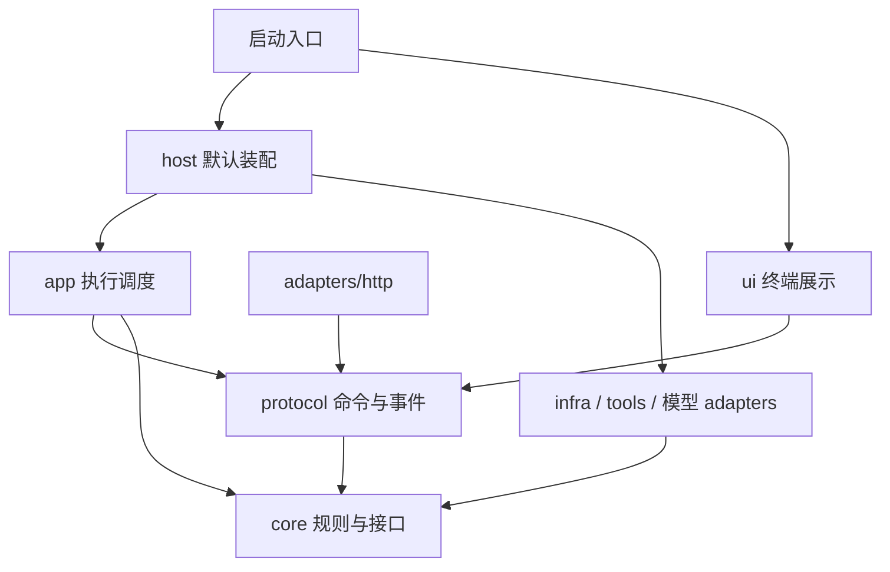

# Mini Agent 架构与代码阅读指南

对应 V1.2.0 开发代码。版本方向见 [技术规划](./doc/technical-roadmap.md)，扩展代码示例见 [模块开发](./doc/module-development.md)。

## 1. 依赖方向



`core` 定义数据和规则，`app` 编排运行流程，`host` 选择具体实现。执行层只看到 `ExecutionServices` 中需要的能力，不知道工作区文件位置、终端或默认存储类。

`ui` 的项目内依赖只允许指向 `ui` 与 `protocol`。协议类型不引用存储、模型厂商或宿主实现。HTTP 服务也依赖客户端契约及快照方法，不要求具体的 AgentRuntime 类。

`npm run check:boundaries` 检查静态导入、类型导入和字面量动态导入；`npm run check` 自动运行它。它用于发现层间反向依赖，不能替代运行环境隔离。

## 2. 目录职责

| 目录                                  | 负责                                   | 关键文件                                                       |
| ------------------------------------- | -------------------------------------- | -------------------------------------------------------------- |
| `core/model/`                         | 消息、模型接口、结束原因、模型元数据   | `types.ts`、`message-schema.ts`、`catalog.ts`                  |
| `core/context/`                       | 上下文接口、预算与压缩策略、Token 估计 | `ports.ts`、`manager.ts`、`tokens.ts`                          |
| `core/tools/`                         | 工具注册、参数校验、调用与委托         | `ports.ts`、`registry.ts`                                      |
| `core/permissions/`                   | 权限策略与审计接口                     | `ports.ts`、`manager.ts`                                       |
| `core/workflow/`                      | 图定义、校验、绑定与条件路由           | `definition.ts`、`ports.ts`                                    |
| `core/execution/`                     | 四层状态、结果投影类型、验收报告约束   | `types.ts`、`ports.ts`、`acceptance.ts`                        |
| `core/memory/`                        | 记忆数据与存取接口                     | `types.ts`、`ports.ts`                                         |
| `app/tasks/`                          | Task/Run 生命周期与持久化边界          | `runner.ts`                                                    |
| `app/execution/`                      | 固定外层流程、调用记录、模型和工具动作 | `engine.ts`、`model-step.ts`、`node-actions.ts`、`observer.ts` |
| `app/nodes/`                          | 节点执行器、注册目录与可用性校验       | `types.ts`、`catalog.ts`、`agent.ts`、`model.ts`、`tool.ts`    |
| `protocol/`                           | JSON 命令、事件、快照与校验            | `contracts.ts`、`commands.ts`、`index.ts`                      |
| `host/`                               | 服务工厂、宿主生命周期与客户端命令派发 | `dependencies.ts`、`services.ts`、`runtime.ts`                 |
| `adapters/models/`                    | 提供方协议、发现与能力解析             | `openai-compatible.ts`、`anthropic.ts`、`gemini.ts`            |
| `infra/storage/`                      | 原子 JSON、执行状态、历史、记忆、日志  | `atomic-json.ts`、`execution-store.ts`、`task-persistence.ts`  |
| `infra/workspace/`                    | 工作区路径、授权目录、项目状态         | `files.ts`、`project-state.ts`                                 |
| `infra/configuration/`                | 文件配置、密钥、工具别名与工作流目录   | `workflows.ts`、`configured-tools.ts`                          |
| `infra/extensions/`                   | Skills 加载和 MCP 连接                 | `skills.ts`、`project-mcp.ts`                                  |
| `infra/permissions/`、`verification/` | 文件审计、审批预览、文件完整性检查     | `file-audit.ts`、`files.ts`                                    |
| `tools/`                              | 工具描述、参数 Schema、注册与执行      | `local.ts`、`command.ts`、`memory.ts`、`todos.ts`              |
| `ui/`                                 | 终端交互与展示投影                     | `view-model.ts`、`command-router.ts`、`terminal/`              |

工具注册与存储分别维护。例如 `tools/todos.ts` 定义模型可调用的操作，`infra/storage/todo-store.ts` 保存数据。权限策略通过 `PermissionAuditPort` 写审计，不直接打开日志文件。

## 3. 四层对象与三类状态

```text
Session：交流范围
└─ Task[]：持续目标、目标版本、交付清单与行动计划
   └─ Run[]：一次推进、工作流快照、业务 State、游标和指标
      └─ NodeRun[]：一次进入节点的输入、输出、状态与 Attempt
```

| 数据                                | 归属                | 作用                                 |
| ----------------------------------- | ------------------- | ------------------------------------ |
| WorkflowDefinition / NodeDefinition | 配置目录及 Run 快照 | 描述要执行什么                       |
| `run.state.data`                    | Run                 | 节点间传递业务数据                   |
| Run / NodeRun / Operation           | 执行记录            | 描述实际发生了什么                   |
| Session.history                     | 会话                | 保存规范的消息和工具结果             |
| UI 展示状态                         | 客户端内存          | 草稿、滚动位置、工具折叠、思考与提示 |

业务 State 不包含生命周期和权限字段。输出映射只能写 `state.*`，客户端只能通过命令改变运行状态。

## 4. 一次命令的路径

1. UI 将输入变成结构化 Command。斜杠语法由 `ui/command-router.ts` 处理。
2. AgentRuntime 校验命令、检查是否可并发操作，调用 TaskRunner。
3. TaskRunner 选择或新建目标，创建 Run，通过 TaskPersistencePort 保存。
4. ExecutionEngine 准备清单与计划；必要时产生持久等待请求。
5. 图调度建立 NodeRun，解析输入，选取节点执行器。
6. 执行器通过受观察的 Agent、模型或工具动作产生输出。
7. 内核校验输出，提交 State 与下一节点游标后才继续。
8. 执行图到达 `$end` 后，内核调用 DeliveryPort 检查，缺失文件重新进入执行子图。
9. 保存结果，再发出完成事件；客户端根据事件和快照刷新。

Human 节点的持久等待由内核管理。普通节点插件只拿到输入副本、配置副本、取消信号和对应的受控动作，不直接拿到可修改的 Task/Run。

## 5. 可替换模块如何连接

`host/dependencies.ts` 是默认 Node 宿主的装配入口。未提供工厂时使用默认实现；提供工厂时由工厂负责创建相应能力。

- 模型和 Agent 循环分别替换，统一 Model、AgentLoopPort。
- ContextPolicyPort 在启动、会话切换、上下文配置更新时使用同一工厂创建。
- MemoryPort 同时供上下文召回和记忆工具使用，避免形成两份互不一致的记忆。
- PermissionPort 负责决策，PermissionAuditPort 负责记录；计划确认是独立等待。
- TaskPersistencePort 保存 Task/Run/NodeRun 及兼容缓存，工作流目录使用 WorkflowCatalogPort。
- DeliveryPort 负责实际观察，内核再检查报告归属、每项覆盖和状态一致性。
- 节点执行器以名称注册；配置通过 `config.executor` 选择，Human 等待保持内核语义。
- 工具模块可以关闭，宿主模块有 setup / dispose 生命周期，观察器通过结构化事件接入。

这些扩展是受信任宿主代码；接口分离不构成代码沙箱。默认宿主仍管理本地会话索引、密钥和项目配置。替换任务存储不等于把整个宿主自动迁移到数据库。

## 6. 保存、恢复与事件

默认权威记录位于 `.mini-agent/executions/<session>.json`，一次原子写入同时保存 Run 状态、NodeRun、State、游标、等待、报告和规范历史。执行层查询返回最近成功提交的副本。

保存失败不能报告成功。兼容 `sessions/` 与 `tasks/` 缓存失败会单独提示，不覆盖已提交的权威结果。V1.1 数据可读取为兼容视图，不伪造完整 Task。

正常暂停发生在节点边界。重启发现进行中的 Run 会标记 interrupted，显式确认后重新启动中断节点；已经发生的外部动作可能重复。当前没有跨进程写锁和历史检查点回放。

事件包含 scope；execution 事件另有 generationId 和修订号。观察器或某个 UI 抛错不影响其他订阅者与执行。慢同步观察器仍会占用宿主事件循环，应由扩展自行排队处理。

## 7. 阅读顺序与验证

建议按以下顺序，每次只跟一条路径：

1. `core/model/types.ts` → `core/agent.ts`：模型与工具循环。
2. `core/workflow/definition.ts` → `core/execution/types.ts`：配置和运行对象。
3. `app/ports.ts` → `app/tasks/runner.ts` → `app/execution/engine.ts`：依赖与生命周期。
4. `app/nodes/` → `app/execution/node-actions.ts`：如何扩展节点并保留调用记录。
5. `host/dependencies.ts` → `host/services.ts`：默认实现如何装配。
6. `protocol/index.ts` → `adapters/http/client.ts` → `ui/view-model.ts`：同一个 Agent 如何接不同 UI。

`tests/modules.test.ts` 用离线模型检查模块工厂、扩展节点、不可跳过的验收和模块清理。原有核心、权限、HTTP、终端测试继续保留。自动化检查不替代真实提供方和用户终端兼容性验证。
