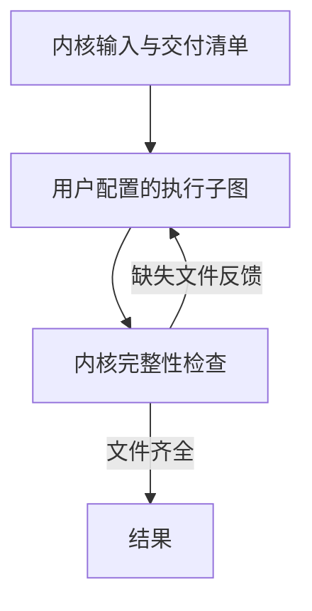

# LangGraph 设计思路与节点设计参考

整理日期：2026-10-23。依据 LangGraph 官方 JavaScript/TypeScript 文档；本文是学习笔记与设计参考，不代表项目已接入 LangGraph。

## 1. 核心抽象

LangGraph 用有状态的图组织执行。主要概念如下：

| 概念         | 作用                                       |
| ------------ | ------------------------------------------ |
| State        | 图内共享数据；各字段有自己的更新与合并方式 |
| Node         | 读取状态、执行工作、提交状态更新的函数     |
| Edge         | 定义下一步激活哪些节点，包括条件分支与循环 |
| Runtime      | 调度节点、应用更新并支持流式观察等运行能力 |
| Checkpointer | 按执行步骤保存状态，支持跨调用继续与恢复   |

Graph API 显式声明图，适合研究配置化编排；Functional API 使用函数、分支和任务组织逻辑，两者共享底层运行时。

参考：[Graph API](https://docs.langchain.com/oss/javascript/langgraph/graph-api)、[Functional API](https://docs.langchain.com/oss/javascript/langgraph/functional-api)。

## 2. 状态与节点接口

节点可以是普通计算、模型调用、工具调用、完整 Agent 或子图。LangGraph 的基本抽象是可执行函数，应用可以在其上定义业务节点类型。

节点返回本次更新的字段，运行时负责合并。状态可以包含原始输入、中间结果、产物引用、消息和业务变量；不要求仅使用聊天消息。

下例是用于理解的普通 TypeScript 伪代码，不是完整 SDK 用法：

```ts
type ExecutionState = {
  request: string;
  sources: string[];
  draft: string;
  outputFiles: string[];
};

async function writeDraft(state: Readonly<ExecutionState>): Promise<Partial<ExecutionState>> {
  const draft = await generateDraft(state.request, state.sources);
  return { draft };
}
```

图的输入输出 Schema 可以与内部状态区分。运行依赖和配置也可以通过 runtime context 提供，避免把模型实例、连接等对象混入需要保存的业务状态。

本项目需要进一步区分：

- 图状态：节点间传递的结构化数据。
- 模型上下文：某次调用实际发送给模型的消息与材料。
- 会话历史：用户和助手的长期交互记录。

节点使用图状态构造模型上下文，是应用需要定义的逻辑。并非所有图状态都需要发送给每个模型。

参考：[状态更新](https://docs.langchain.com/oss/javascript/langgraph/use-graph-api#define-and-update-state)、[运行上下文](https://docs.langchain.com/oss/javascript/langgraph/graph-api#runtime-context)。

## 3. Reducer 与并行

Reducer 按字段定义旧值与更新怎样合并，例如覆盖、追加或按键合并。普通字段的顺序更新默认覆盖旧值；并行节点在同一步写入不支持多写的同一字段，会产生冲突错误。

例如两个节点分别收集资料后返回：

```text
节点 A：sources = [资料 A]
节点 B：sources = [资料 B]
```

如果该字段采用列表追加规则，可以汇总两个结果。需要稳定顺序时，应附带排序键后显式整理；重复执行需要去重时，也要另外设计合并逻辑。

Reducer 处理图状态，不协调磁盘上多个节点同时改同一文件的冲突。

参考：[并发状态更新错误](https://docs.langchain.com/oss/javascript/langgraph/errors/INVALID_CONCURRENT_GRAPH_UPDATE)、[分支与并行](https://docs.langchain.com/oss/javascript/langgraph/use-graph-api#create-branches)。

## 4. 边、动态路由与调度

固定边定义后继；条件边读取状态决定路径。返回多个目的节点可以产生分支，连接回已有节点可以形成循环。

- `START` 与 `END` 表达图的入口和结束路径。
- `Command` 可以同时提交状态更新并指定后续节点；静态边仍会执行，配置时需要避免意外同时触发多条路径。
- `Send` 可以针对一组数据，动态调度同一节点的多个实例，并为每个实例传入不同数据。

动态路由或动态任务数量不意味着必须运行时新增节点定义。

底层 Pregel 按 super-step 组织执行：先确定本步激活的节点，并行执行，再应用更新；本步写入在后续步骤可见。此处调度中的 Plan 是选择待执行节点，不是让大模型生成行动计划。

应用要明确分支汇合是否等待全部依赖。图执行可以因正常结束、等待输入或异常等不同原因停止，不能仅凭流停止判断任务成功。

参考：[Pregel](https://docs.langchain.com/oss/javascript/langgraph/pregel)、[Command 与 Send](https://docs.langchain.com/oss/javascript/langgraph/graph-api#command)、[图 API 用法](https://docs.langchain.com/oss/javascript/langgraph/use-graph-api)。

## 5. 编译、恢复与子图

### 编译

定义状态、注册节点并连边后，调用 `compile()` 得到可执行图。编译进行基本结构检查，并接入检查点等运行选项；业务效果由节点实现和运行结果决定。

### 检查点与中断

配置 Checkpointer 后，可以按 super-step 保存状态和执行位置。`thread_id` 用于关联连续调用的状态，不能简单等同于本项目的一条消息或一次 Run。

`interrupt()` 暴露可序列化的输入请求，随后通过恢复值继续。恢复时相关节点函数可能从头执行，不会直接恢复一个 JavaScript 函数栈；外部副作用需要幂等、执行回执或可持久化任务等机制配合。

检查点与跨任务长期记忆分工不同；内存检查点也不等于进程重启后仍存在的数据。

### 子图

子图可以作为父图的节点。父子共享适合的状态字段时，可以直接组合；状态不同或需要私有数据时，通过包装函数映射输入和输出。

参考：[检查点](https://docs.langchain.com/oss/javascript/langgraph/checkpointers)、[中断](https://docs.langchain.com/oss/javascript/langgraph/interrupts)、[持久化](https://docs.langchain.com/oss/javascript/langgraph/persistence)、[子图](https://docs.langchain.com/oss/javascript/langgraph/use-subgraphs)。

## 6. 可观测与应用边界

LangGraph 支持观察状态更新、模型消息、子图和运行输出等。UI 可以消费这些运行数据；业务状态与显示布局保持分工。

节点重试、缓存和循环保护属于可配置的运行机制。是否重试外部动作、如何取消、如何限制资源，仍需业务策略配合。

LangGraph 的通用函数节点并不自动提供本项目需要的文件权限、执行沙箱、凭据边界或交付完整性标准，这些能力需要通过应用的受控执行入口落实。

参考：[事件流](https://docs.langchain.com/oss/javascript/langgraph/event-streaming)、[重试配置](https://docs.langchain.com/oss/javascript/langgraph/use-graph-api#add-retry-policies)。

## 7. 对本项目的设计启发，尚未定稿

建议保留以下关系：



用户子图的 `END` 表示本次执行阶段结束，仍需要回到内核检查交付文件。当前范围继续只检查交付物齐全，内容评审留作后续扩展。

以下是基于项目目标提出的建议，不是 LangGraph SDK 自动提供的配置格式：

| 待设计项 | 需要明确的问题                                 |
| -------- | ---------------------------------------------- |
| 节点定义 | 唯一 ID、执行器引用、静态参数分别是什么        |
| 输入绑定 | 节点读整个图状态，还是通过映射读取指定字段     |
| 输出映射 | 节点结果写入哪些字段，采用什么合并规则         |
| 流程控制 | 固定后继、条件分支、等待与错误策略怎样声明     |
| 执行实例 | 循环与并发中，同一节点定义对应不同 NodeRun     |
| 执行环境 | 工具、模型、上下文管理、权限和取消信号如何注入 |

配置化工作流需要由本项目实现加载、校验、执行器注册与映射。使用 Graph API 的设计思想不代表已经决定采用 LangGraph 作为底层依赖。

建议先讨论节点与状态的输入输出关系，再定义 JSON/YAML 字段。此建议仍待确认。

## 8. 四层对象结构与 LangGraph 的区别

补充日期：2026-10-23。以下将官方概念与本项目的候选模型进行对照；映射和选型均为设计建议，未决定接入框架。

### 8.1 执行机制接近，应用语义需要自行定义

本项目提出的共享 State、函数节点、条件边、循环、检查点、人工等待与 LangGraph 的运行思路相近。这些结构可以建立在其上，不需要为了保留四层对象就自行重写图引擎。

比较时需要区分：

- 开源 LangGraph 库：图、状态更新与合并、执行、检查点和流式观察等。
- Agent Server / LangSmith Deployment：进一步提供 Assistant、Thread、Run 等服务资源与管理接口。
- LangSmith 可观测能力：执行追踪等；追踪中的 run 也不能直接当作本项目的业务 Run。

官方参考：[Graph API](https://docs.langchain.com/oss/javascript/langgraph/graph-api)、[持久化](https://docs.langchain.com/oss/javascript/langgraph/persistence)、[Assistant 与配置的边界](https://docs.langchain.com/langsmith/assistants)、[流式输出与追踪入口](https://docs.langchain.com/oss/javascript/langgraph/streaming)。

### 8.2 对象只能按用途映射，不能直接替换名称

| 本项目对象 | LangGraph 中相关概念             | 差别                                                                                                    |
| ---------- | -------------------------------- | ------------------------------------------------------------------------------------------------------- |
| Session    | Thread 的会话容器用途            | 本项目 Session 汇总多个 Task；Thread 主要划定累积状态与检查点的范围，是否对应会话需要应用决定           |
| Task       | 应用自行定义的用户目标对象       | 本项目明确保存跨多轮目标、计划、交付清单、累积产物和最终结果；不能用内部 PregelTask 替代                |
| Run        | 图的一段执行；服务层的 Run       | 存在对应思路，但本项目 Run 包括准备、执行、检查、补交和结果；暂停后的多次框架调用可能仍属同一个业务 Run |
| NodeRun    | 调度任务信息、节点事件和执行追踪 | 可以据此建立执行记录，但要自行定义稳定身份、循环重入、重试、输出提交与指标聚合的规则                    |

LangGraph 的 StateSnapshot 包含 values、next、metadata、tasks 等信息。这里的 PregelTask 是调度执行单元；Functional API 中的 task 则是可持久化工作的组织方式。两者都不能直接等同于“用户目标”这个 Task。

官方参考：[Thread 跨 Run 保存状态](https://docs.langchain.com/langsmith/use-threads)、[StateSnapshot 与 PregelTask](https://docs.langchain.com/oss/javascript/langgraph/checkpointers)、[节点中的持久化任务](https://docs.langchain.com/oss/javascript/langgraph/graph-api#using-tasks-in-nodes)。

### 8.3 State 的归属是需要注意的实际差异

候选模型中，每个业务 Run 有自己的 State；开始新的 Run 时，通过明确引用选择需要继承的输入。

LangGraph 配置 Checkpointer 后，使用同一个 thread_id 的连续调用会沿该 Thread 保存和继续图状态。因此，直接把所有任务都放进一个与 Session 同名的 Thread，可能让不同目标的业务数据混在一起。

一种可行映射是：

```text
业务 Session S1
├─ Task T1
│  ├─ Run R1 → LangGraph Thread R1，暂停与恢复继续使用它
│  └─ Run R2 → LangGraph Thread R2，显式选择旧产物作为输入
└─ Task T2
   └─ Run R3 → LangGraph Thread R3
```

也可以为 Task 分配 Thread，但必须另外定义新业务 Run 启动时如何重置或迁移 State。以上均为适配策略，不是框架强制映射。

使用 Agent Server 时，同一业务 Run 的初次执行、等待后恢复等可能对应多个服务层 Run，适配记录应保留各自 ID，不能要求它们天然一一对应。

### 8.4 本项目更具体的约束

| 关注点         | 本项目的拟议约束                             | 使用 LangGraph 时的处理                                    |
| -------------- | -------------------------------------------- | ---------------------------------------------------------- |
| 用户目标       | 显式 Task，独立于聊天和执行次数              | 在应用层维护 Task 模型与命令                               |
| 完成规则       | 生成交付清单，执行后检查实际文件，缺失则补交 | 用受控父图或外层控制器落实该循环；图结束本身不证明交付完整 |
| 用户配置       | 配置文件声明节点、参数、绑定与分支           | 加载、校验配置，并将注册执行器组装成图                     |
| 状态权限       | 普通节点只能更新允许的业务字段               | 使用受控输入输出适配；自定义代码的权限边界另行落实         |
| 上下文         | 策略可配置，记录实际使用的计划、压缩和记忆   | 在模型调用入口实现策略与记录，再利用框架持久化或流式能力   |
| UI             | 统一任务、审批、提示、工具和指标协议         | 将框架流式输出转换为本项目事件与查询视图                   |
| 工具权限与隔离 | 分层授权、受控工具、按需沙箱                 | 宿主实现具体执行入口；图结构本身不提供文件或进程隔离       |

LangGraph 具备状态与模型输出流式能力，多端适配同样可以建立在它的接口上；“UI 解耦”不能作为它缺少的能力。项目需要进一步统一自己面向任务的客户端协议。

上述应用约束是根据本项目需求提出的设计判断，不表示 LangGraph 无法实现这些行为。当前完整性检查继续只检查文件齐全，不引入内容评审。

### 8.5 如果采用框架，应复用哪些部分

建议保留本项目的目标模型与对外协议：

```text
TUI / Web / 桌面 / App
          ↓
本项目协议、Session / Task / Run 管理
          ↓
内核清单与结果规则、配置加载、权限和上下文策略
          ↓
LangGraph 适配器
          ↓
图调度、状态合并、检查点、等待恢复与流式输出
```

具体外层生命周期放在父图还是宿主控制器中仍需比较。可将强制检查节点放在受控父图中，将用户工作流作为执行子图；自定义配置只能修改子图。

若采用 LangGraph，图状态、调度位置和检查点应以引擎存储为相应事实来源；本项目保存关联引用或查询投影，避免同时维护两套独立可写的调度器。业务 Task、清单、产物和对外结果继续由宿主定义，跨存储一致性仍需适配。

自己实现图引擎也可保留这套四层协议，但需要自行承担并行合并、重试、持久化、崩溃恢复、子图与事件一致性等工作。四层对象设计并不等于这些运行保证已经实现。
