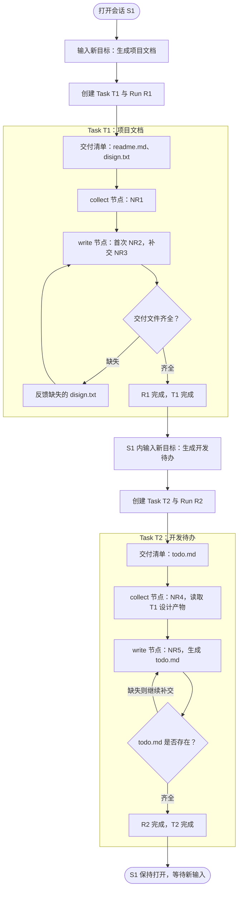

# 同一会话连续执行多个 Task 的流程与状态示例

整理日期：2026-10-23。状态：按当前讨论方案构造的示例；字段、枚举和存储结构尚未定稿，当前代码尚未完整实现。

## 1. 示例前提

- 会话为 S1，始终保持打开。
- 用户明确先后提出两个新目标，串行执行；本例不决定是否支持并发 Task。
- 默认自主执行，没有开启执行前计划确认；具体工具仍遵守权限策略。
- 每个 Task 独立生成生效交付清单。
- 验收只根据清单检查文件是否齐全，不做内容质量或模型语义评审。
- 自动补缺失文件沿同一 Run 的反馈循环继续；重新进入节点时创建新的 NodeRun。
- 两个任务复用同一份执行工作流定义 W1/v1，包含 collect 和 write 两个节点。

Task 目标：

| 对象 | 用户目标                   | 交付清单              | 执行 |
| ---- | -------------------------- | --------------------- | ---- |
| T1   | 生成项目说明和设计文档     | readme.md、disign.txt | R1   |
| T2   | 根据刚才的设计生成开发待办 | todo.md               | R2   |

T1 中的第一次执行只生成 readme.md，完整性检查发现缺少 disign.txt，执行器补齐后通过。T2 通过明确的产物引用读取 T1 的设计文件。

## 2. 完整流程图



路径、权限和检查器异常走独立的等待或异常处理分支，图中省略以突出两个 Task 的正常完成及补交路径。

## 3. 逐步查看状态变化

下列状态名用于说明，正式枚举另行确定。Session 的 open 表示会话尚未关闭，执行是否忙碌由活动任务、运行和运行状态表达。

| 时刻                | Session S1 的活动引用 | T1        | R1                    | T2 / R2               | 工作流 State 与执行记录                                   |
| ------------------- | --------------------- | --------- | --------------------- | --------------------- | --------------------------------------------------------- |
| A：打开会话         | 无活动任务            | 未创建    | 未创建                | 未创建                | 尚无执行状态                                              |
| B：接收第一个目标   | T1 / R1               | active    | running / preparing   | 未创建                | 为 R1 创建自己的初始 State，生成交付清单                  |
| C：第一次写文件后   | T1 / R1               | active    | running / verifying   | 未创建                | NR1、NR2 完成；R1.state.artifacts 只有 readme.md          |
| D：发现缺文件并补交 | T1 / R1               | active    | running / executing   | 未创建                | 记录 missing = [disign.txt]；NR3 执行，继续复用 R1 的状态 |
| E：第一个任务完成   | 无活动任务            | completed | completed / finalized | 未创建                | R1 保存两个文件引用及通过报告，历史 NodeRun 保留          |
| F：接收第二个目标   | T2 / R2               | completed | completed             | active / running      | 为 R2 创建独立 State，通过引用接入 T1 的设计产物          |
| G：第二个任务完成   | 无活动任务            | completed | completed             | completed / completed | R2 保存 todo.md 及通过报告，NR4、NR5 保留                 |

Task 内的完整性检查未通过，不必立刻把 Task 或 Run 标记为失败；本例仍在同一 Run 中继续执行。NR2 正常结束也不代表 T1 完成，最终需要外层检查交付文件齐全。

## 4. 快照一：T1 正在补交文件

此时第一次完整性检查结束，NR3 已经开始补交。下面是为了讲解聚合展示的数据，不要求物理保存在一个 JSON 文件中。

```json
{
  "session": {
    "id": "S1",
    "status": "open",
    "activeTaskId": "T1",
    "activeRunId": "R1"
  },
  "task": {
    "id": "T1",
    "sessionId": "S1",
    "status": "active",
    "goal": "生成项目说明和设计文档",
    "deliverables": ["readme.md", "disign.txt"],
    "runIds": ["R1"]
  },
  "run": {
    "id": "R1",
    "taskId": "T1",
    "workflowRef": "W1/v1",
    "status": "running",
    "phase": "executing",
    "state": {
      "materials": ["项目资料引用"],
      "artifacts": [{ "artifactId": "A1", "path": "readme.md", "version": 1 }]
    },
    "completeness": {
      "checklistVersion": 1,
      "status": "incomplete",
      "present": ["readme.md"],
      "missing": ["disign.txt"]
    },
    "nodeRuns": [
      { "id": "NR1", "nodeId": "collect", "status": "completed" },
      { "id": "NR2", "nodeId": "write", "status": "completed" },
      {
        "id": "NR3",
        "nodeId": "write",
        "status": "running",
        "inputs": {
          "missingFiles": ["disign.txt"],
          "existingArtifactRefs": ["A1"]
        }
      }
    ]
  }
}
```

其中：

- R1.state 是本次执行共享的业务数据。
- completeness 是内核完整性检查报告，不与业务 State 混为同一写入权限。
- NR2 和 NR3 来自同一个静态 write 节点，是不同执行实例。
- 清单仍保持原来的两个目标文件，执行器只接收缺失项反馈，不通过删除清单项来取得通过。
- 补交完成时，框架将 NR3 的新产物合并到 R1.state.artifacts，再重新检查清单文件。

## 5. 快照二：T2 开始，复用 T1 的设计产物

```json
{
  "session": {
    "id": "S1",
    "status": "open",
    "activeTaskId": "T2",
    "activeRunId": "R2"
  },
  "task": {
    "id": "T2",
    "status": "active",
    "goal": "根据 T1 的设计生成开发待办",
    "deliverables": ["todo.md"],
    "sourceArtifactRefs": [{ "taskId": "T1", "artifactId": "A2", "version": 1 }],
    "runIds": ["R2"]
  },
  "run": {
    "id": "R2",
    "taskId": "T2",
    "workflowRef": "W1/v1",
    "status": "running",
    "phase": "executing",
    "state": {
      "materials": [],
      "artifacts": []
    },
    "nodeRuns": [{ "id": "NR4", "nodeId": "collect", "status": "running" }]
  }
}
```

NR4 根据来源引用读取 A2，并把需要的资料写入 R2 的 State；后续 NR5 生成 todo.md。R2 不默认复制 R1 的全部业务状态、计划和执行日志。

会话历史可以帮助找到“刚才的设计”指向哪个产物，进入执行后应保存明确来源。本例使用产物版本引用来表达依赖；版本化读取的具体实现待设计。

两个任务可以使用同一个文件工作区；逻辑状态独立不自动提供文件系统隔离。若后续任务修改早期文件，需另外处理产物版本和相关检查的失效规则。

## 6. 两个完整 Task 结束后的内部归属

```text
Session S1 [open，当前无活动 Task/Run]
├─ messages：T1 输入/结果、T2 输入/结果，保留任务关联
├─ Task T1 [completed]
│  ├─ goal：生成项目说明和设计文档
│  ├─ deliverables：readme.md、disign.txt
│  ├─ artifactRefs：A1、A2
│  └─ Run R1 [completed]
│     ├─ workflowRef：W1/v1
│     ├─ State：本次资料、产物引用 A1/A2
│     ├─ 完整性报告：曾缺 disign.txt，补交后齐全
│     └─ NodeRuns
│        ├─ NR1：collect [completed]
│        ├─ NR2：write [completed，仅产生 readme.md]
│        └─ NR3：write [completed，补交 disign.txt]
└─ Task T2 [completed]
   ├─ goal：根据设计生成开发待办
   ├─ sourceArtifactRefs：T1 的 A2/v1
   ├─ deliverables：todo.md
   ├─ artifactRefs：A3
   └─ Run R2 [completed]
      ├─ workflowRef：W1/v1
      ├─ State：本次设计资料、产物引用 A3
      ├─ 完整性报告：todo.md 齐全
      └─ NodeRuns
         ├─ NR4：collect [completed]
         └─ NR5：write [completed]
```

W1/v1 的 collect、write 是复用的定义，各 Task 的 NodeRun 保存各自的执行信息。实际报告可以按检查次数分别保存，最新摘要引用最后一次检查；字段协议尚待定稿。

## 7. 本例需要保持的边界

1. Session 容纳多个 Task，某个 Task 完成后 Session 可以继续接收新目标。
2. 本例每个 Task 只有一个 Run，自动补交不创建新 Task 或 Run。稍后独立重跑、继续已结束的执行时如何建立新 Run，需要遵守正式的任务协议。
3. 用户回复当前运行的澄清或审批请求，可继续原 Run，不因收到一条新消息而必然创建新 Task。
4. 每次 Run 管理自己的工作流 State，节点通过显式映射读取并提交更新。
5. 同一节点再次执行时有独立实例；异常重试的 attempt 粒度仍待讨论。
6. 运行结束后状态、报告和执行记录继续保留，活动任务指针可以清空。
7. completed 在本例中依据的是交付文件完整性策略，不表示内容正确性已被检查。

本文演示的是目标架构，不改变既有 V1.1 的运行时行为，也不将示例字段直接视为正式 API。
