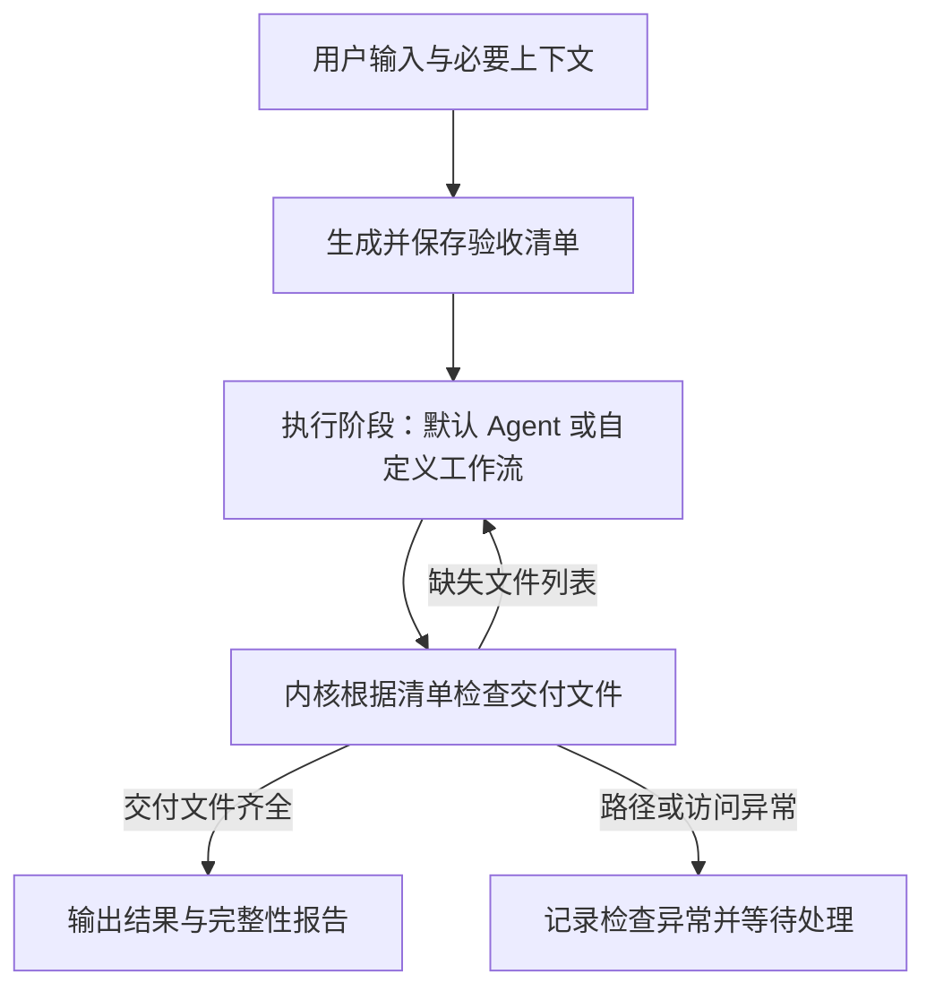

# 通用工作流结构与验收闭环

最后整理：2026-10-23。状态：本轮用户提案与设计建议；尚未实现。

实施更新：本结构已纳入 V1.2 并实现串行执行闭环，详见 [当前实现指南](./v1.2-usage.md)。纯回复任务允许交付回答，文件检查标记不适用；以下文件验收规则继续作用于文件交付任务。

## 当前已确认范围：只做完整性检查

用户已明确本阶段验收只做完整性检查。当前范围具体记录为：

- 框架根据生效清单逐项核对交付文件是否存在，路径对应的对象应为文件。
- 清单缺失项反馈到执行阶段；已有成果继续复用。
- 全部列出的交付文件齐全时，记录“完整性检查通过”。
- 路径或访问异常单独记录为检查异常，避免将无法读取状态直接视为文件缺失。
- 非空、可读性、文件格式等附加检查规则待另行确认。

本阶段不做模型语义验收、内容质量评审、置信度打分，也不自动证明清单已经覆盖全部用户要求。先前的内容检查和独立验收会话方案保留为后续讨论。

该决定限定的是讨论中的验收设计，不代表现有 V1.1 已实现新的清单检查机制。

## 1. 本轮讨论的范围

先讨论工作流外层结构和执行阶段的自定义边界，后续再逐项确定验收清单、状态机和配置协议。

用户提出的通用路径：输入 → 执行 → 验收 → 结果。

进一步提出：

- 输入阶段由模型根据用户需求生成验收所需的清单，通过工具提交。
- 执行阶段运行 Agent，产出交付文件。
- 框架根据验收清单检查实际产物；未满足时反馈给执行阶段继续处理。
- 用户自定义的工作流位于“执行”阶段内部。
- 生成验收清单和检查验收清单由内核统一安排，所有工作流都必须经过。

**已澄清：工具参数中提到的 `README.md` 等文件名，指待交付、待检查的文件，而非验收清单自身的文件名。**

以上作为本轮方向记录；清单字段、检查规则和恢复策略仍需逐项讨论。

## 2. 建议的外层结构

输入准备可以包含必要的澄清和授权范围内的只读信息收集，便于形成与实际环境一致的验收要求。是否允许、允许哪些动作待讨论。

建议内核持有外层生命周期，执行阶段作为可替换的子工作流：

- 默认执行器运行一个自主 Agent。
- 用户配置的执行器可包含多个 Agent、模型、工具、路由和人工输入节点。
- 子工作流结束后提交候选结果，由外层验收决定后续处理。
- 内部可以增加检查节点；最终完成仍经过外层验收。

建议执行器统一接收任务目标、生效验收清单、相关上下文、已有产物及上次验收报告，返回候选产物和执行证据。正式接口待设计。

## 3. 先区分三类记录

| 记录       | 作用                                     | 建议管理方                       |
| ---------- | ---------------------------------------- | -------------------------------- |
| 验收清单   | 说明需要交付什么、满足什么条件、如何检查 | 模型提出，内核校验、版本化保存   |
| 实际交付物 | 用户需要的 README、报告、数据或外部资源  | 执行阶段生成或更新，登记产物引用 |
| 验收报告   | 每项检查的结果、观察证据、失败原因       | 内核调用检查器后记录             |

行动计划另行描述“准备如何完成目标”，验收清单描述“满足什么条件才算完成”。步骤标记完成不直接等于验收通过。

清单和报告可导出到任务目录，实际交付物按用户要求的目录保存。内核同时保留结构化记录和明确的产物引用，避免仅依赖扫描整个文件夹。

执行阶段自行写出的“已通过”说明可作为提交材料，最终通过状态需要由框架执行检查后生成。

## 4. 验收清单需要包含什么

本阶段先确定交付目标列表，用明确路径标识待检查文件。正式字段、相对路径基准、可选项等结构仍待讨论。

以下需求条件与检查方式是此前提出的扩展方案。除文件齐全检查外，均未纳入当前范围：

以下为建议内容，字段名称、工具名称和内置检查器均未定稿：

- 目标：交付物类型、路径或资源引用。
- 要求：可追溯到用户目标的具体条件。
- 检查方式：使用哪个检查器、参数及预期结果。
- 必需性：必需项与可选项。
- 身份：清单版本、验收项 ID、关联任务与需求版本，由框架管理。

以 `README.md` 为例：

| 要求                   | 可采用的检查方式           | 判断范围               |
| ---------------------- | -------------------------- | ---------------------- |
| 文件存在且非空         | 文件读取与长度检查         | 文件生成情况           |
| 包含安装和启动说明     | Markdown 结构与内容规则    | 指定说明是否出现       |
| 命令引用与项目配置一致 | 读取项目配置，执行规则比较 | 可明确比较的命令与配置 |
| 说明准确、适合目标读者 | 带依据的模型评审或人工检查 | 记录判断依据及不确定性 |

检查章节标题出现不能直接证明文档准确。检查器应明确说明实际检查了什么。

模型可通过工具一次提交交付目标和验收项；工具校验并保存。只传文件名时，还需要从任务目标和上下文中取得具体要求，不能单凭文件名推导全部完成标准。

## 5. 清单的稳定性与权限

建议在执行前建立生效的验收清单。返工继续使用该版本，避免执行过程中为追求通过而降低标准。

- 需求变化时走明确的清单修订流程，保存差异和来源。
- 默认自主执行不等于每次都必须由用户确认清单；是否提供确认开关待讨论。
- 执行器可以提出清单修订，不能直接覆盖生效标准。
- 配置文件或清单不能自行授予新权限。
- 检查器使用注册的受控实现；执行命令或访问外部服务仍遵守授权与隔离规则。
- 模型生成的标准可能遗漏需求；应保留与用户要求的对应关系及未澄清项。

清单可追踪，不能保证模型理解必然正确；检查结果应保留证据和不确定性。

用户曾提出启用独立临时会话，先检查 `readme.md`、`disign.txt` 等交付物齐全，再结合任务描述判断内容达标，并关注模型判断的可信度。用户随后决定本阶段只保留完整性检查；临时会话与置信度相关提案暂存于 [独立验收会话与判断可靠性](./verification-review.md)。

## 6. 验收结果与反馈

本阶段结果先区分：文件齐全、缺失交付文件、检查异常。缺失项返回执行阶段；异常记录原因并按恢复或等待策略处理。通过只表示清单中的文件齐全。

以下为后续通用验收扩展的建议：按验收项记录通过、未满足、证据不足、检查器异常或不适用及理由。必需项不能仅因未检查而被视为通过。

| 情况                                     | 建议后续动作                                 |
| ---------------------------------------- | -------------------------------------------- |
| 必需项通过，其他完成策略满足             | 整理结果并结束                               |
| 文件缺失、内容不符合明确规则等可修复问题 | 将差异与证据交回执行阶段                     |
| 缺少授权或必要用户信息                   | 等待用户处理                                 |
| 证据不足，需要人工判断                   | 等待补充证据或人工验收                       |
| 检查器不可用或基础设施异常               | 按错误类别恢复或等待，不能直接认定交付物失败 |
| 用户取消                                 | 结束当前执行，保留已完成工作与未验收原因     |

失败反馈建议关联清单版本、验收项、产物版本、实际观察、预期条件和检查日志。

验收回退时应在失败相关节点或修复入口继续，复用已有成果；避免将发送消息、写入外部系统等步骤全部重新执行。外部副作用需要执行回执与幂等机制配合。

本轮不新增固定模型轮数上限。持续无进展、预算、检查器重试和等待策略另外讨论，不采用无条件重复整个流程的方式处理所有失败。

## 7. 面向通用任务的边界

文件是首批可支持的交付物类型。通用任务还可能交付消息、结构化数据、网页链接、远端记录或操作回执。

建议统一使用产物与检查器接口，使文件检查成为一种实现；普通问答也可以经过轻量的输出检查，无须强制生成磁盘文件。

这项设计是否第一版即覆盖非文件产物，仍待确认。

## 8. 与 TDD 的关系

本提案采用先确定检查标准、再执行、根据检查反馈修正的思路。编码场景可以进一步落实为先写失败测试、实现使测试通过、再重构的 TDD 循环。

通用任务可将这种方式称为验收驱动执行，使用与任务匹配的检查器。

参考：[Martin Fowler 对 TDD 的说明](https://martinfowler.com/bliki/TestDrivenDevelopment.html)。

## 9. 尚待讨论

一次确定一个问题：

1. 文件交付清单的最小结构：路径基准、文件列表，以及非空等附加规则是否需要。
2. 清单生成前允许的信息收集，以及何时需要用户澄清或确认。
3. 完整性检查结果与执行阶段的反馈接口。内容检查器和模型评审留作后续扩展。
4. 清单修订与返工入口。
5. 文件目录约定、非文件产物、缓存失效与增量验收。

## 10. 当前实现

最初讨论基于 V1.1：当时仅根据实际命令证据汇总验证。当前 V1.2 已实现清单准备、完整性检查与缺失补交；本节保留原设计背景，实际范围见 V1.2 配置指南。

本文记录设计，不代表对应运行机制已经完成。
